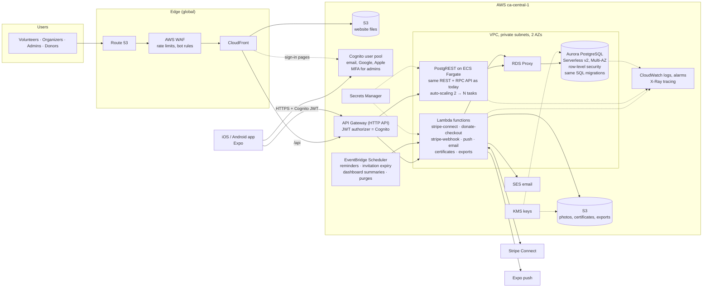

# Target architecture on AWS

Image for slides: [`img/aws-target.png`](img/aws-target.png) (also `img/aws-target.svg`). Regenerate it whenever the diagram below changes.

Region **ca-central-1 (Montréal)**, so volunteer data stays in Canada. Separate AWS accounts for dev, staging and production. Everything is defined in AWS CDK ([`infra/`](../../infra/)).

## What each part does

| Component | Replaces | Why this choice |
|---|---|---|
| S3 + CloudFront | Hostinger | Same static build. Global CDN; cost scales with traffic. |
| AWS WAF | — | Rate limits (open security item 11), common attack rules. |
| Cognito | Supabase Auth | Managed sign-in, Google/Apple, MFA for admins, leaked-password protection. |
| API Gateway | Supabase gateway | One entry point, JWT check, throttling. |
| PostgREST on Fargate | Supabase REST | The app's data calls keep working with almost no code change. |
| Lambda | Edge Functions | Stripe, push, email, PDFs: short jobs, pay per use. |
| Aurora PostgreSQL Serverless v2 | Supabase Postgres | Same PostgreSQL. Capacity scales with load, Multi-AZ failover, read replicas for dashboards. |
| RDS Proxy | — | Pools connections when Lambda and Fargate scale out. |
| EventBridge Scheduler | pg_cron + pg_net | Reminders, expiries, dashboard summaries, data purges. |
| SES | Supabase email | Sign-up, password and announcement emails. |
| Secrets Manager + KMS | Function secrets | Stripe keys, database credentials; encryption at rest. |
| CloudWatch + X-Ray | Supabase logs | Dashboards and alarms: API errors, slow queries, webhook failures, cost. |

## Environments
| | dev | staging | production |
|---|---|---|---|
| Aurora | Serverless v2, min 0.5 ACU | min 0.5 ACU | min 1 ACU, Multi-AZ, 1 reader |
| Fargate (PostgREST) | 1 task | 1 task | 2–10 tasks |
| Backups | 1 day | 7 days | 35 days + point-in-time restore |
| Data | demo only | copy of demo + anonymised sample | real |
