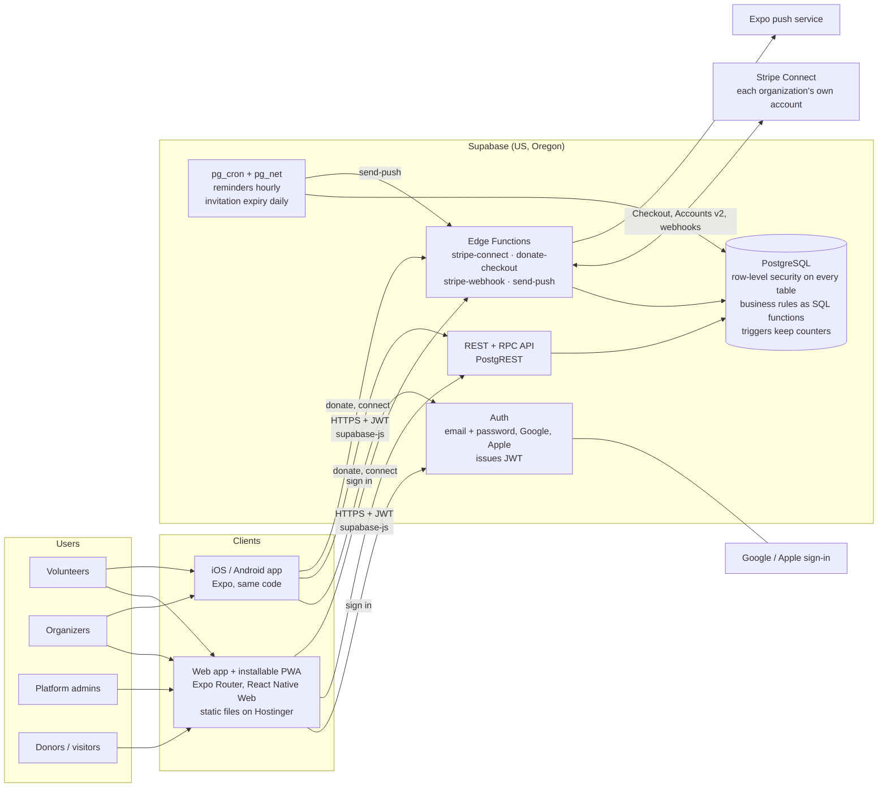

# Architecture today (as built, November 2026)

Image for slides: [`img/current.png`](img/current.png) (also `img/current.svg`). Regenerate it whenever the diagram below changes.

## Notes
- **One database holds all the rules.** Capacity, privacy, hours, matching and demo separation are enforced in PostgreSQL, so web, mobile and any future client get the same behaviour.
- **The website is static files.** The build (`npm run build:web`) is uploaded to Hostinger. `.htaccess` adds HTTPS, deep links and security headers (CSP, frame, HSTS, permissions).
- **Secrets are server-side only.** The app holds only the public Supabase URL and anon key. Stripe keys live in Supabase function secrets.
- **Deployments:**
  - database: `node scripts/db.mjs migrate`
  - functions: `node scripts/deploy-functions.mjs`
  - website: zip upload
