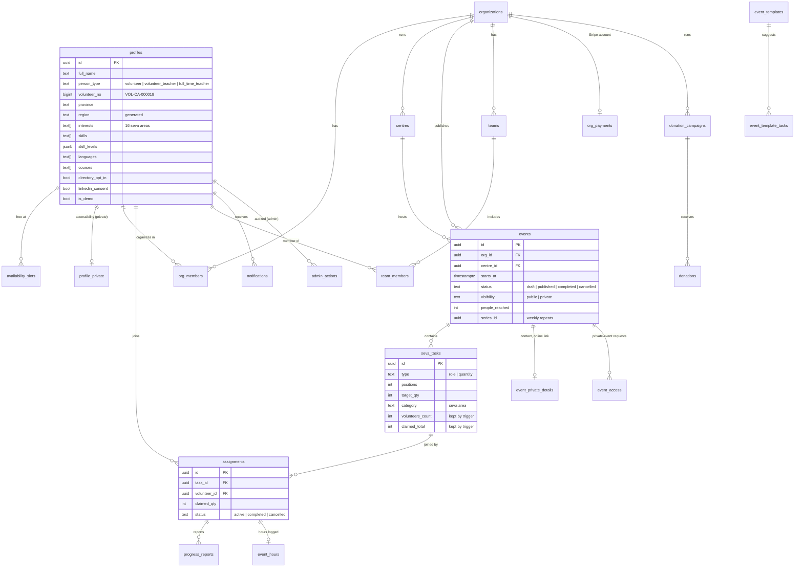

# Data model (main tables)

All tables live in the `public` schema with row-level security on.
- Every table: [`supabase/migrations/`](../../supabase/migrations/)
- Generated TypeScript types: `src/lib/database.types.ts`

## Row counts to plan for (50,000 volunteers, one year)
| Table | Estimate | Notes |
|---|---|---|
| profiles | 50,000 | |
| availability_slots | ~300,000 | 6 slots per person on average |
| events | ~10,000 | ~200 centres × 1 a week |
| seva_tasks | ~40,000 | |
| assignments | ~400,000 | 8 seva per active volunteer |
| progress_reports | ~200,000 | |
| notifications | ~3,000,000 | Archive after 180 days (planned job) |

All of these are small for PostgreSQL when indexed. The planned archive job keeps `notifications` small.
