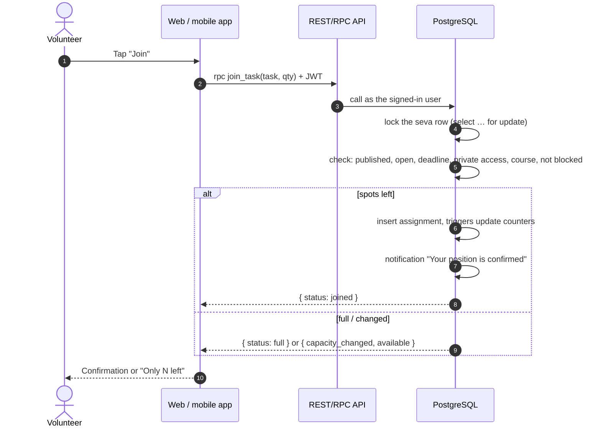
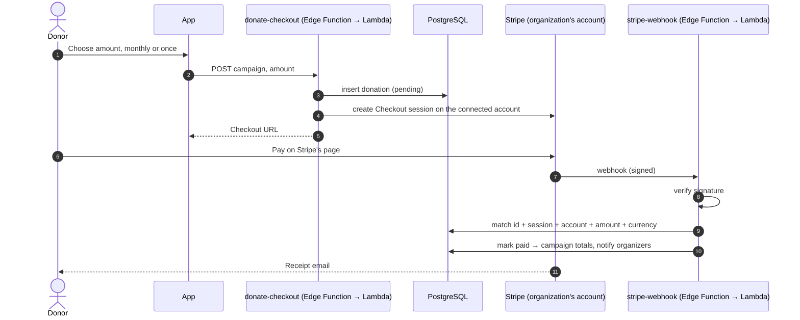
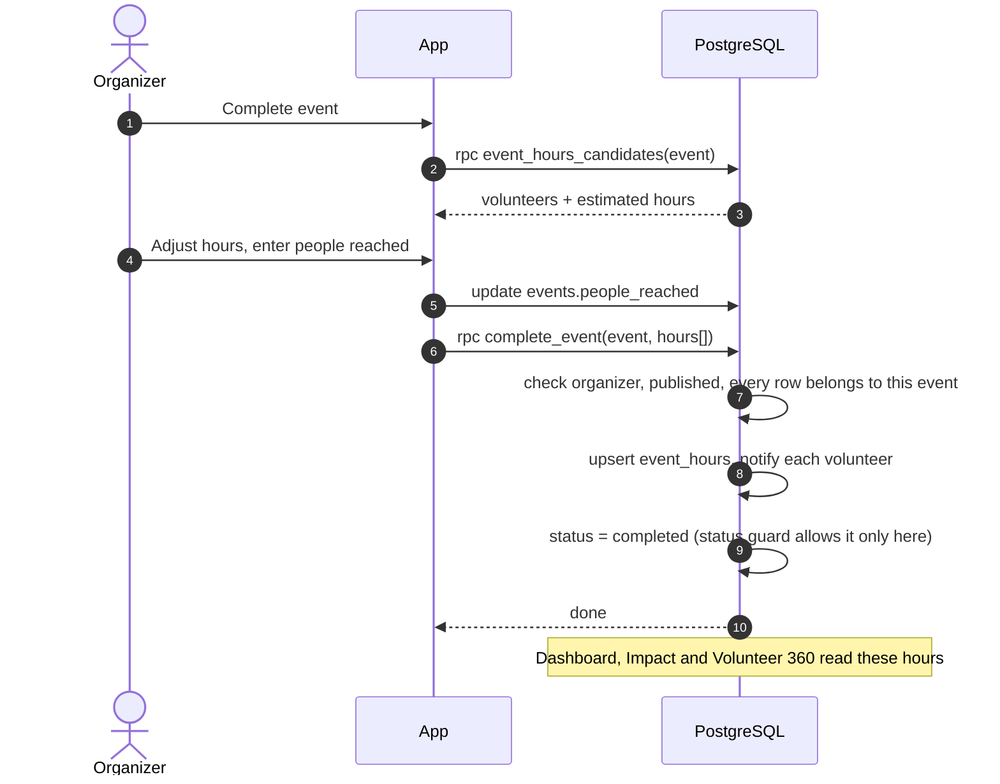

# Key request flows

Images for slides: [`img/flow-join.png`](img/flow-join.png), [`img/flow-donate.png`](img/flow-donate.png).

## 1. Join a seva (no overbooking)

Two people pressing Join at the same moment are served one after the other, because of the row lock, so the last spot is never sold twice.

## 2. Donate (money goes straight to the organization)

## 3. Complete an event and log hours

